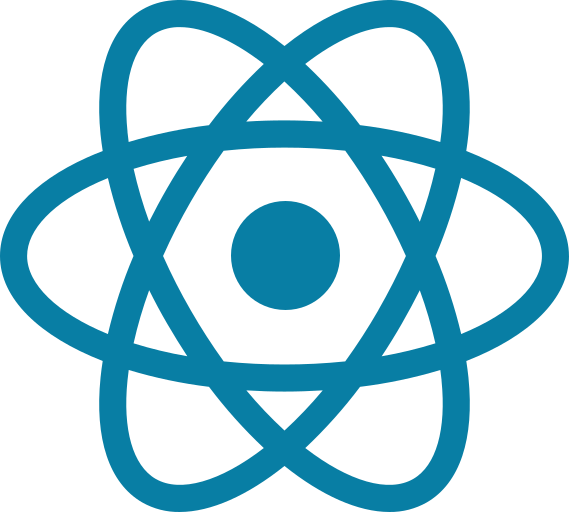
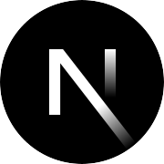

<pre align="center">
/\_/\
( o.o )
&gt; ^ &lt;
</pre>

  <strong>hola, soy manuel</strong> 
  <strong>Desarrollador full stack · Bogotá, Colombia</strong> 
  Interfaces cuidadas, productos SaaS e IA.

  <code>UI/UX</code> · <code>Programación</code> · <code>IA &amp; RAG</code> · <code>Cloud</code>

  &nbsp;&nbsp;
  <picture><source media="(prefers-color-scheme: dark)" srcset="assets/stack/react-dark.svg"></picture>&nbsp;&nbsp;
  &nbsp;&nbsp;
  &nbsp;&nbsp;
  &nbsp;&nbsp;
  &nbsp;&nbsp;
  <picture><source media="(prefers-color-scheme: dark)" srcset="assets/stack/aws-dark.svg"></picture>&nbsp;&nbsp;
  

  <a href="https://manudev.vercel.app/es/">Portafolio</a> ·
  <a href="https://www.linkedin.com/in/manuekle/">LinkedIn</a> ·
  <a href="mailto:meerazo7@hotmail.com">Correo</a>

<a href="README.md">English</a> · Español

