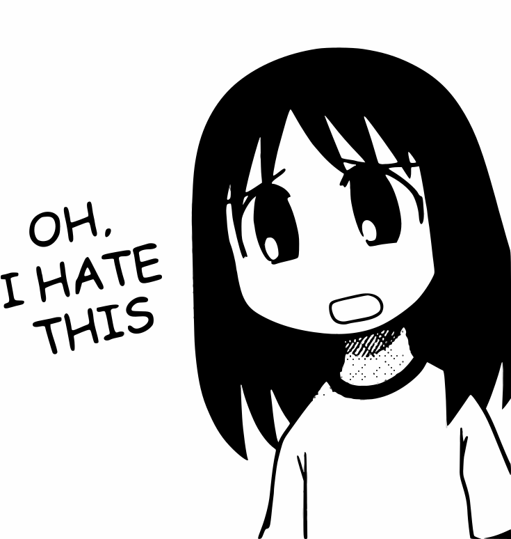
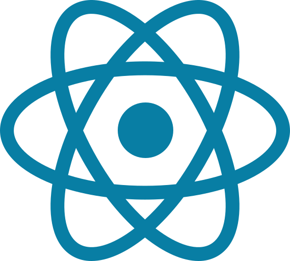
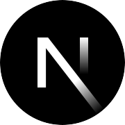

  

  <strong>hi, i'm manuel</strong> 
  <strong>Full stack developer · Bogotá, Colombia</strong> 
  Thoughtful interfaces, SaaS products &amp; AI.

  <code>UI/UX</code> · <code>Programming</code> · <code>AI &amp; RAG</code> · <code>Cloud</code>

  &nbsp;&nbsp;
  <picture><source media="(prefers-color-scheme: dark)" srcset="assets/stack/react-dark.svg"></picture>&nbsp;&nbsp;
  &nbsp;&nbsp;
  &nbsp;&nbsp;
  &nbsp;&nbsp;
  &nbsp;&nbsp;
  <picture><source media="(prefers-color-scheme: dark)" srcset="assets/stack/aws-dark.svg"></picture>&nbsp;&nbsp;
  

  <a href="https://manudev.vercel.app/">Portfolio</a> ·
  <a href="https://www.linkedin.com/in/manuekle/">LinkedIn</a> ·
  <a href="mailto:meerazo7@hotmail.com">Email</a>

English · <a href="README.es.md">Español</a>

